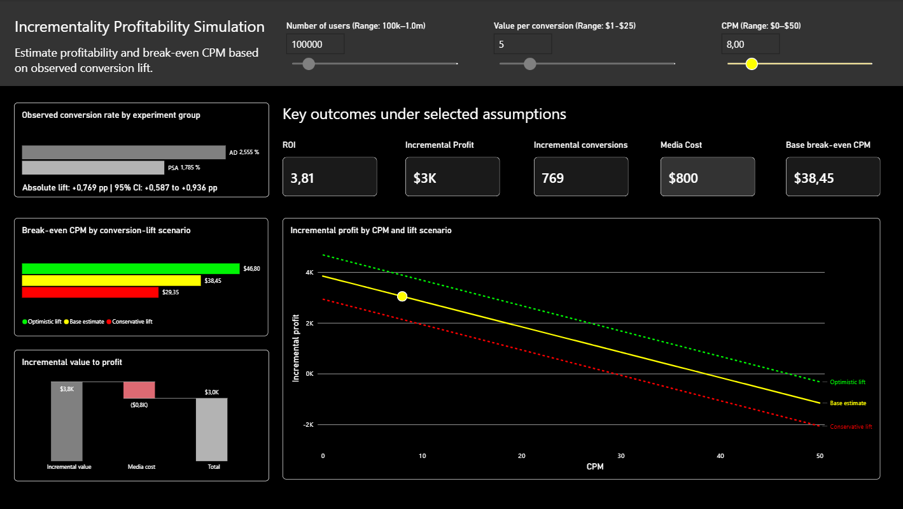
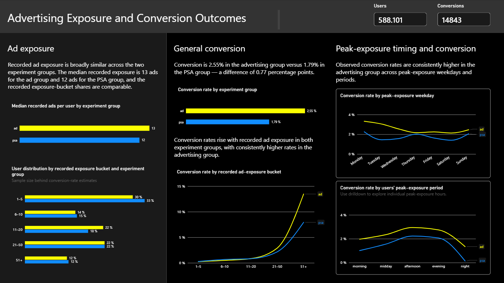

# From Experiment to Impact

## A/B Test Evaluation and Campaign Scenario Planning

This project evaluates a publicly available marketing A/B test to assess whether advertising exposure is associated with a higher recorded conversion rate than a PSA (public service announcement) control group. It also translates the observed difference into transparent business scenarios for reach, cost and profit.

The analysis is a Python evaluation (`02_notebooks/`) plus a Power BI report with an interactive profitability simulation.

## Business question

> Does the advertising treatment outperform the PSA control group, and under which assumptions would the estimated conversion lift create meaningful incremental business value?

## Data

**Marketing A/B Testing** dataset by Favio Vázquez, Kaggle: <https://www.kaggle.com/datasets/faviovaz/marketing-ab-testing>

| | Advertising group (`ad`) | PSA control (`psa`) |
| --- | --- | --- |
| Users | 564,577 | 23,524 |
| Conversions | 14,423 | 420 |
| Conversion rate | 2.555 % | 1.785 % |

Total: 588,101 users, 14,843 conversions.

### Experiment design and data checks

- **Group sizes:** The PSA control group makes up only about **4 %** of users (23,524 of 588,101). The split is clearly unbalanced, so the control-group estimate carries most of the statistical uncertainty.
- **Randomisation:** The source does not document the randomisation mechanism, the intended allocation ratio, the experiment duration, the conversion window or the campaign economics. Results are therefore reported as differences in recorded conversion between the two groups. Because the planned allocation is unknown, the 96:4 split cannot be formally classified as a sample-ratio mismatch. Day, hour and exposure fields were compared descriptively between groups; they are recorded after assignment and cannot verify randomisation.
- **Data quality:** 588,101 rows, 588,101 unique user IDs, no duplicates, no user in more than one group, no missing values, and all values within valid ranges (binary outcome, 0–23 hours, valid weekdays).
- **Exposure variables** (total ads seen, peak-exposure day and hour) are recorded **after** assignment. They are used for description only, not for causal conclusions.

## Method

1. Validate the data (duplicates, missing values, group sizes).
2. Compare conversion rates between the two groups.
3. Test the difference with a two-sided two-proportion z-test (`statsmodels`) and compute a 95 % score confidence interval for the absolute lift.
4. Explore conversion by exposure bucket, peak-exposure weekday and time period.
5. Translate the lift into business scenarios (conservative, base, upside).

## Key results

| Topic | Result |
| --- | --- |
| Population | 588,101 users, 14,843 conversions |
| Conversion, advertising group | 2.55 % |
| Conversion, PSA group | 1.79 % |
| **Absolute lift** | **0.769 percentage points** (95 % CI 0.587 to 0.936) |
| **Relative lift** | **43.1 %** relative to the PSA rate (95 % CI approx. **30.0 % to 57.5 %**, log-ratio method) |
| Statistical test | Two-proportion z-test: z = 7.37, p = 1.7 × 10⁻¹³ |
| Recorded exposure | Median 13 ads (`ad`) vs. 12 ads (`psa`) |

**Reading the exposure results:** Conversion rises in the highest exposure bucket and varies by peak-exposure weekday and time. These are descriptive user segments, not randomised treatment levels. They do not show that showing more ads caused more conversions.

## Profitability simulation (scenario planning)

Incremental conversions = reach × absolute conversion lift
Incremental value = incremental conversions × value per conversion
Incremental profit = incremental value − media cost

### Example calculation

Assumptions used for the example (also adjustable in the report):

| Assumption | Value |
| --- | --- |
| Users reached | 100,000 (adjustable from 100k to 1.0m) |
| Value per conversion | $5 (adjustable from $1 to $25) |
| Media cost (CPM) | $8 |

Result at $8 CPM: **769** incremental conversions, media cost **$800**, incremental profit **$3,045**, ROI **3.81** (profit ÷ cost).

| Lift scenario | Absolute lift | Incremental profit at $8 CPM | Break-even CPM |
| --- | --- | --- | --- |
| Conservative | 0.587 pp | $2,135 | approx. $29.4 |
| Base estimate | 0.769 pp | $3,045 | approx. $38.5 |
| Optimistic | 0.936 pp | $3,880 | approx. $46.8 |

The chart "Incremental profit by CPM and lift scenario" shows how profit falls as CPM rises; each line crosses zero at its break-even CPM.

The scenario charts show how profit and break-even CPM change across conservative, base and optimistic lift values (the confidence-interval bounds).

> The simulation is a decision-support prototype, not a production budget-allocation model. Currency values are illustrative.

## Recommendation

**Continue the campaign and scale it in phases, but run a cleaner follow-up test before a large rollout.**

**Why:** The ad group converts at 2.555 % versus 1.785 % for the PSA control (+0.769 pp, 95 % CI 0.587 to 0.936). At the example assumptions ($8 CPM, $5 per conversion, 100,000 users) the campaign is profitable even at the lower confidence bound: about $2.1K profit and ROI 2.67 in the conservative case, about $3.0K and ROI 3.81 in the base case. At $8 CPM a conversion only needs to be worth about $1.04 (conservative case: $1.36) to break even.

**Next steps:**

1. **Confirm the real value per conversion and the real media cost.** They are the largest open drivers of the result and are assumptions here, not data.
2. **Plan a follow-up experiment** with a documented allocation ratio, fixed duration and conversion window, a stopping rule, a power calculation and secondary metrics (e.g. retention, returns).
3. **Do not raise ad frequency on the basis of this data.** Conversion rises with recorded exposure, but exposure buckets are not randomised. Test frequency (and any frequency cap) directly.
4. **Treat timing and segment patterns as hypotheses.** Peak-exposure weekday and time of day are descriptive. Verify them in a randomised test with multiple-comparison correction before shifting budget.

**Caveat:** The effect is statistically clear, but causal only if the original assignment was random. The control group is about 4 % of users and the source does not document the allocation.

## Dashboard

**Page 1 – Incrementality Profitability Simulation**



**Page 2 – Exploratory Exposure and Conversion Outcomes**



**Availability:** The Power BI file is not published in this repository; the screenshots above document the report.

## Limitations

- The control group is small relative to the treatment group (see data checks above).
- Randomisation could not be verified; the source does not document it.
- Exposure and timing analyses are descriptive only.
- Value per conversion and CPM are assumptions, not observed data.
- Only recorded conversion is measured. Longer-term effects (retention, returns) are outside the data.

## Tools

- Python: pandas, statsmodels, matplotlib, seaborn
- Power BI and DAX for the dashboard and the profitability simulation
- Git and GitHub

## Repository structure

```
.
├── 01_data/
│   ├── 01_raw/              # Original source data; not committed
│   └── 02_processed/        # Processed data; not committed
├── 02_notebooks/            # Data validation, analysis and statistical testing
├── 03_outputs/              # Tables and static figures
├── 04_dashboard/            # Power BI files; not committed
├── 05_screenshots/          # Dashboard and analysis screenshots
└── README.md
```

## Run it yourself

1. Download the dataset from Kaggle (link above) and place it in `01_data/01_raw/`.
2. Run the notebooks in `02_notebooks/` in numerical order.